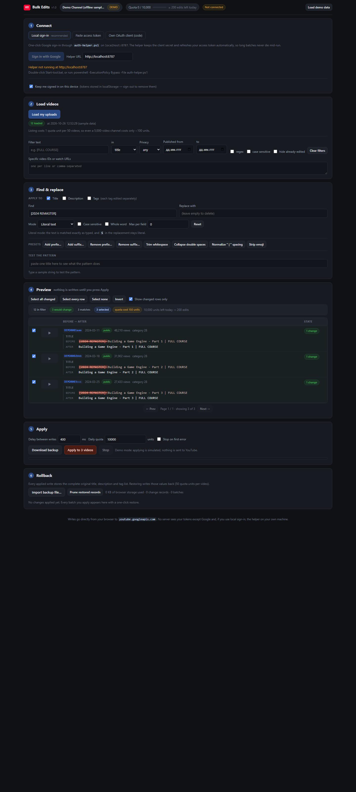

# YouTube Bulk Edits

Bulk find-and-replace for your YouTube video **titles, descriptions and tags**,
with a full before/after preview, quota budgeting, and one-click rollback.

Pure HTML/CSS/JS — no build step, no dependencies, no server required. Requests go
straight from your browser to `youtube.googleapis.com`.

---

## Try it in 30 seconds, no Google account needed

Double-click **`Open-tool-nohelper.bat`** (or just open `index.html`), then press
**Load demo data** in the top-right.

That loads 12 sample videos and switches the tool into demo mode: everything works
— filtering, patterns, the preview, applying, rollback — but writes are simulated
locally instead of sent to YouTube. Use it to learn the tool before touching a real
channel.

For real use, follow **[SETUP.md](SETUP.md)** once (~10 minutes), then
**`Start-tool.bat`** → **Sign in with Google**.

You can also open the demo straight from a URL: `index.html?demo=1`.



---

## The workflow

| # | Section | What you do |
|---|---|---|
| 1 | **Connect** | Sign in (local helper), paste an access token, or use your own OAuth client with PKCE |
| 2 | **Load videos** | Pull every upload (~2 quota units per 50 videos), then narrow with filters |
| 3 | **Find & replace** | Choose fields, literal or regex, case/whole-word, presets |
| 4 | **Preview** | Read the exact before → after for every video; nothing is written here |
| 5 | **Apply** | Confirm, watch progress, stop at any time |
| 6 | **Rollback** | Restore any batch, or a single video, from stored snapshots |

### The preview is the point

Every row shows the original and the result side by side, with the exact matched
text struck through in red and the exact inserted text highlighted in green:

```
before   [2024 REMASTER] Building a Game Engine - Part 1 | FULL COURSE
         └── struck through in red ──┘
after    Building a Game Engine - Part 1 | FULL COURSE
```

Those highlights are not a cosmetic diff. The engine returns the precise character
ranges it will remove and insert, so what you see is literally what will be sent.
Tags are shown as chips and edited **one tag at a time**, so a match can never
spill across a tag boundary.

Rows that would break YouTube's limits (title over 100 characters, empty title,
description over 5,000, tag list over 500 characters total) are marked **blocked**,
cannot be selected, and are never sent to the API.

### Patterns

- **Literal** — text matched exactly as typed; regex metacharacters are escaped for
  you, and `$` in the replacement stays a literal `$`.
- **Regex** — full JavaScript syntax, including `$1`, `$<name>`, `$&`, `` $` ``,
  `$'` and `$$` in the replacement. Extra flags (`m`, `s`, `u`) supported.
- **Whole word** — unicode-aware, so it works on Cyrillic/Greek/etc., not just ASCII.
- **Max per field** — cap replacements per video.
- **Presets** — add/remove prefix or suffix, trim whitespace, collapse double
  spaces, normalise ` | ` spacing, strip emoji.
- **Test box** — paste one title and see the result instantly before touching 500 videos.

### Filters

Text (literal or regex) over title / description / tags / ID / any field, privacy
status, published-date range, an explicit list of video IDs or watch URLs, and
"hide already-edited" so you can work through a channel in several passes.

---

## Safety model

Things that protect you, in the order they kick in:

1. **Dry-run by default.** Loading and previewing never write anything.
2. **Validation before sending.** Over-limit results are blocked, not attempted.
3. **Quota budgeting.** The header shows units used today out of 10,000 and how
   many edits remain. A batch that would not fit is refused with the number of
   videos you *can* do today. The counter resets at midnight Pacific, matching
   YouTube's own reset.
4. **Explicit confirmation.** Apply shows the video count, field list, replacement
   total and quota cost. For 25+ videos you must type `APPLY`.
5. **Automatic backup file.** A JSON backup of all snapshots downloads before the
   first write of a batch.
6. **Full snapshots.** Each write stores the *complete* original snippet (title,
   description, tags, category, language, localizations) — because
   `videos.update` **deletes any property you omit**, a partial snapshot could not
   restore losslessly. The write path echoes back every untouched field for the
   same reason, so editing a title can never wipe your tags or description.
7. **Rollback.** Per batch or per video, at any later time, from the stored
   snapshot or an imported backup file. Restoring costs 50 units per video and is
   itself recorded (so an undo can be undone).
8. **Throttling + retry.** Writes are sequential with a configurable delay;
   rate limits and 5xx errors back off exponentially and retry, while quota
   exhaustion aborts the batch immediately instead of burning through it.
9. **Stop button.** Cancels after the current video; everything already written is
   recorded and restorable.

### Honest limits

- **200 edits/day** (10,000 units ÷ 50), and rollback consumes the same budget.
- **Refresh tokens expire after 7 days** while your Google Cloud app is in
  "Testing" mode. That is a Google policy for unverified apps; you will need to
  sign in again about weekly. See SETUP.md.
- **Paste-token mode lasts ~1 hour.** If a long batch dies mid-way with an auth
  error, reconnect and re-run — completed edits stay completed and restorable.
- **Rollback lives in this browser's localStorage** (~5 MB). If you clear site
  data, switch browser, or move machine, restore from the exported JSON backup
  with **Import backup file**. The header shows storage usage and warns loudly
  *before* it runs out, rather than silently discarding history.
- Only videos the signed-in account **owns** can be edited.

---

## Files

```
yt-bulk-edits/
├── index.html              the app (open directly, or served by the helper)
├── styles.css
├── js/
│   ├── util.js             DOM/format helpers
│   ├── transform.js        find & replace engine, validation, write/restore bodies
│   ├── store.js            settings, auth, change log, quota ledger, backups
│   ├── api.js              YouTube Data API v3 client: retry, pagination, quota
│   ├── auth.js             three sign-in modes, PKCE, token refresh
│   ├── demo.js             offline sample channel
│   └── ui.js               rendering, preview, apply pipeline, rollback
├── auth-helper.ps1         optional localhost sign-in broker + static server
├── Start-tool.bat          helper + browser, one double-click
├── Open-tool-nohelper.bat  open the page straight from disk
├── SETUP.md                Google Cloud credentials guide
└── tests/
    ├── harness.html        unit suite (99 tests)
    ├── tests.js
    ├── autotest.js         end-to-end DOM driver (16 steps)
    └── run-tests.bat       runs both in headless Chrome
```

`js/*.js` are plain scripts sharing a `YTBE` namespace, deliberately **not** ES
modules — modules are blocked by CORS on a `file://` page, and opening
`index.html` by double-clicking has to keep working.

The helper writes `auth-config.json` and `tokens.json` next to itself at runtime.
Both are plaintext; keep them out of any public repo or synced share.

---

## Running the tests

No Node or Python needed — Chrome *is* the runtime:

```
tests\run-tests.bat
```

It runs both suites in headless Chrome and prints pass/fail counts, exiting non-zero
on any failure.

- **`tests/harness.html`** — 99 unit tests over the engine, API client (with a
  stubbed `fetch`), storage and auth. Includes the RFC 7636 Appendix B PKCE test
  vector, and round-trip proofs that apply→restore returns byte-identical metadata.
- **`index.html?autotest=1`** — 16 end-to-end steps driving the real page: boot,
  demo data, filters, diff markup, validation blocking, the apply pipeline,
  rollback, backup import/export, and an XSS check that a hostile video title can
  never inject markup.

The `?autotest=1` hook is the only test code referenced by the shipped page; it is
inert unless you add that query string yourself.

---

## How it talks to YouTube

| Operation | Endpoint | Quota |
|---|---|---|
| Resolve uploads playlist | `GET /channels?mine=true` | 1 (skipped when already known) |
| List upload ids | `GET /playlistItems?playlistId=…` (paginated, 50/page) | 1 per page |
| Fetch metadata | `GET /videos?id=…` (50 ids per call) | 1 per 50 videos |
| Category names | `GET /videoCategories` | 1 |
| Edit a video | `PUT /videos?part=snippet` | **50** |

Scope requested: `https://www.googleapis.com/auth/youtube`.

The one API behaviour that shapes the whole design: **`videos.update` deletes any
property you do not send.** Ask to change only a title and omit `tags`, and your
tags are gone. So `buildUpdateBody()` always echoes back the complete snippet from
the freshly loaded video, overriding only the fields you actually changed — and
snapshots store the same complete object so rollback is lossless.
